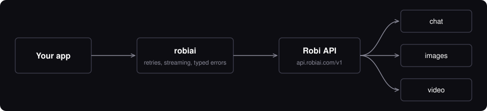

[](https://pypi.org/project/robiai/)


The official Python SDK for the [Robi API](https://console.robiai.com/docs). Published on [PyPI](https://pypi.org/project/robiai/) as `robiai`.

[Install](#install) · [Quick start](#quick-start) · [Chat](#chat) · [Images](#images) · [Video](#video) · [Async](#async) · [Errors](#errors) · [Options](#options)

---

## Why this SDK

| | |
|---|---|
| **One client, three modalities** | `chat`, `images` and `videos` share one key, one base URL and one error model. |
| **Sync and async** | `Robi` and `AsyncRobi` have the same surface. |
| **Streaming that behaves** | Plain iterators. Errors that arrive mid-stream are raised, not swallowed. |
| **Small footprint** | One dependency, `httpx`. Python 3.9+. |
| **Sensible retries** | Exponential backoff on `429` and `5xx`, honoring `Retry-After`. Never retries `4xx` that won't change. |



## Install

```bash
pip install robiai
```

## Quick start

Create a key in the [Robi Console](https://console.robiai.com) (keys look like `sk-...`) and export it:

```bash
export ROBI_API_KEY=sk-...
```

```python
from robiai import Robi

robi = Robi()  # reads ROBI_API_KEY

reply = robi.chat.completions.create(
    model="lime",
    messages=[{"role": "user", "content": "Explain caching in one sentence."}],
)
print(reply["choices"][0]["message"]["content"])
```

> **Server-side only.** Never ship a production key in client-side or distributed code. Call Robi from your backend.

## Models

| Model | Kind | Use it for |
|---|---|---|
| `lime` | chat | Large context: long documents and retrieval |
| `vera` | chat | Chat |
| `prism` | image | Image generation and editing |
| `movi` | video | Short clips with sound |

Rates and the live list come from `robi.models.list()`, which includes each model's `kind` and prices.

## Chat

```python
# Streaming: the last chunk carries usage and an empty choices list
for chunk in robi.chat.completions.create(
    model="lime",
    messages=[{"role": "user", "content": "Write a haiku about caching."}],
    stream=True,
):
    if chunk["choices"]:
        print(chunk["choices"][0]["delta"].get("content", ""), end="")

# Or just collect the text
text = robi.chat.completions.text(model="lime", messages=messages)
```

<details>
<summary><b>Vision, JSON output and reasoning</b></summary>

```python
# Images in messages (data URL or public URL)
robi.chat.completions.create(model="lime", messages=[{
    "role": "user",
    "content": [
        {"type": "text", "text": "What is in this picture?"},
        {"type": "image_url", "image_url": {"url": "data:image/jpeg;base64,..."}},
    ],
}])

# Force valid JSON (describe the shape in a message too)
robi.chat.completions.create(
    model="vera",
    response_format={"type": "json_object"},
    messages=[
        {"role": "system", "content": 'Reply with JSON like {"city": string, "country": string}.'},
        {"role": "user", "content": "Where is the Eiffel Tower?"},
    ],
)

# Adjustable reasoning, for models that support it
robi.chat.completions.create(model="lime", reasoning_effort="high", messages=messages)
```

Any extra keyword argument is forwarded to the model unchanged.
</details>

## Images

Images come back as base64; there is no URL. Write the bytes untouched to keep the C2PA Content Credential.

```python
from robiai import save_b64

img = robi.images.generate(
    model="prism",
    prompt="A red bicycle against a brick wall, golden hour",
    aspect_ratio="4:5",
    style="photorealistic",
)
save_b64(img["data"][0], "out.jpg")

# Edit or restyle 1-4 reference images (path, bytes, file object, or a list)
robi.images.edit(model="prism", image="photo.jpg", prompt="Replace the background with a studio backdrop")
```

<details>
<summary><b>Image options</b></summary>

| Option | Values |
|---|---|
| `n` | 1 to 4 |
| `aspect_ratio` | `1:1` `2:3` `3:2` `3:4` `4:3` `4:5` `5:4` `9:16` `16:9` `21:9` |
| `size` | e.g. `1024x1024` (ignored when `aspect_ratio` is set) |
| `quality` | `standard` (1K), `high` (2K), `ultra` (4K) |
| `style` | `photorealistic` `cinematic` `illustration` `anime` `3d` `watercolor` `line-art` `pixel-art` `isometric` `minimal` |
</details>

## Video

Videos render in the background as a job. `create_and_poll` creates it and waits for you.

```python
video = robi.videos.create_and_poll(
    model="movi",
    prompt="A red bicycle rolling past a brick wall, golden hour",
    seconds=8,
    size="1280x720",
)
robi.videos.download_content(video["id"], "out.mp4")
```

```
queued  ->  in_progress  ->  completed
                         \-> failed   (raises VideoGenerationError, nothing is charged)
```

<details>
<summary><b>Manual polling, image-to-video, listing</b></summary>

```python
v = robi.videos.create(
    model="movi",
    prompt="The camera slowly pushes in as leaves drift across the frame",
    input_reference="photo.jpg",
    aspect_ratio="9:16",
)
robi.videos.retrieve(v["id"])
robi.videos.list(limit=20, order="desc")
robi.videos.delete(v["id"])
```

`create_and_poll(poll_interval=5, timeout=600)`. Clips are kept for 24 hours after completion. Seconds run 4 to 8. Video models bill per second.
</details>

## Async

```python
from robiai import AsyncRobi

async with AsyncRobi() as robi:
    text = await robi.chat.completions.text(model="lime", messages=messages)
```

## Errors

All errors extend `RobiError`. API errors extend `APIError` and carry `status`, `message`, `code`, `type` and `request_id`.

```python
from robiai import RateLimitError, PaymentRequiredError

try:
    robi.chat.completions.create(model="lime", messages=messages)
except PaymentRequiredError as e:
    print("Out of credit:", e.message)
except RateLimitError:
    print("Slow down")
```

| Status | Class | Retried |
|---|---|---|
| 400, 422 | `BadRequestError` | no |
| 401 | `AuthenticationError` | no |
| 402 | `PaymentRequiredError` | no |
| 403 | `PermissionDeniedError` | no |
| 404 | `NotFoundError` | no |
| 413 | `PayloadTooLargeError` | no |
| 429 | `RateLimitError` | yes |
| 5xx | `InternalServerError` | yes |
| network / timeout | `ConnectionError` / `TimeoutError` | yes |

A failed video job raises `VideoGenerationError` with `.code` (for example `audio_filtered`).

## Options

```python
robi = Robi(
    api_key="sk-...",                      # default: ROBI_API_KEY
    base_url="https://api.robiai.com/v1",  # default: ROBI_BASE_URL
    max_retries=2,
    timeout=60.0,                          # seconds per request
    default_headers={},
    http_client=None,                      # your own httpx.Client (proxies, tests)
)
```

Reasoning models can take 30 seconds or more to send a first token. That is normal, so keep the timeout generous for them.

## Development

```bash
python -m venv .venv && .venv/bin/pip install -e '.[dev]'
.venv/bin/pytest
```
